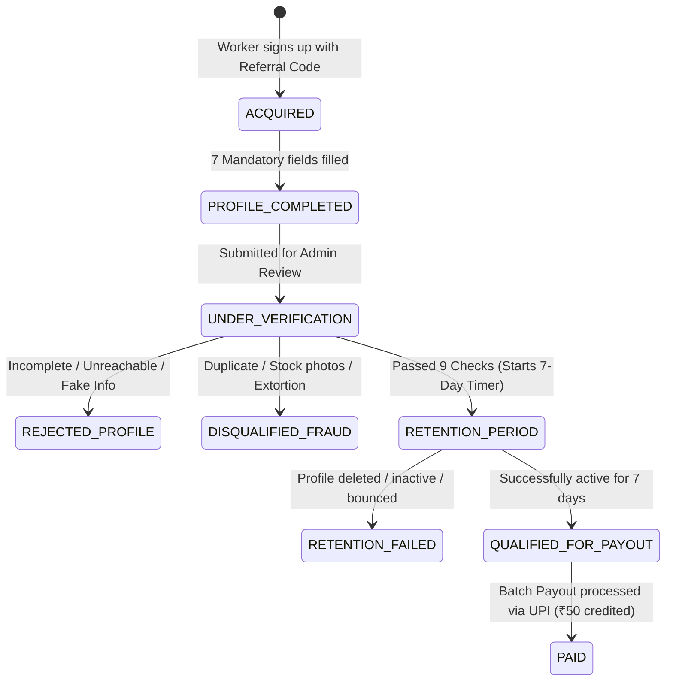

# ProWorker Growth Partners: Backend Architecture & Implementation Guide

> **Document Version:** 1.0.0  
> **Target System:** ProWorker API & Database  
> **Objective:** Power the Sales Partner Referral Program, automated profile attribution, fraud prevention, 7-day retention validation, and weekly UPI commission payouts.

---

## 1. Executive Summary & Program Model

The **ProWorker Growth Partners** program recruits field sales partners to onboard local skilled professionals (plumbers, electricians, carpenters, AC technicians, beauticians, painters, etc.) onto ProWorker.

### Program Core Rules
1. **100% Free Profile Creation:** Creating a profile on ProWorker is completely free for workers. Sales partners are **strictly forbidden** from demanding or taking any money from workers.
2. **Fixed Commission:** Approved sales partners earn **₹50 per verified and retained worker**.
3. **Weekly Payouts:** Commissions are disbursed weekly via **UPI** directly to the partner's registered mobile number / UPI ID.
4. **Current Product Stage Context:** At this stage, ProWorker focuses solely on **creating and verifying rich worker profiles** (contact, trade, bio, photos, service area, availability). Physical product listings are **optional** and not required for qualification.
5. **Anti-Fraud Core:** No commission is paid upfront. Payment occurs **only** after profile verification by the admin team **and** passing a 7-day retention and authenticity check.

---

## 2. The 9-Point Worker Qualification Criteria (₹50 Eligibility)

A referred worker profile **only** qualifies for the ₹50 payout when all 9 criteria are met:

| # | Check Item | Automated vs Manual | Validation Rule |
|---|------------|---------------------|-----------------|
| 1 | **Verified Mobile Number** | Automated | OTP verified via SMS/WhatsApp during registration. |
| 2 | **Complete Name & Profession** | Automated | Name >= 3 chars, profession selected from active category list. |
| 3 | **Profile Photograph** | Automated + Manual | High-resolution face photo (no logos, scenery, or celebrity images). |
| 4 | **Service Description** | Automated | Bio/description >= 30 characters explaining work offerings. |
| 5 | **Operating Territory** | Automated | State, city, and primary area/neighborhood selected. |
| 6 | **Working Days & Hours** | Automated | Availability schedule configured (e.g. Mon–Sat, 9 AM – 7 PM). |
| 7 | **Minimum 2 Work Photographs** | Automated + Manual | At least 2 real photos of actual past work or tools (stock photos rejected). |
| 8 | **Admin Profile Verification** | Manual | ProWorker admin verifies authenticity and calls/audits worker. |
| 9 | **7-Day Retention & Liveness Check** | Automated | Worker profile must remain in good standing for >= 7 days from verification. |

> **Note:** Product catalog listings are **strictly optional**. Do not block approval if product count is 0.

---

## 3. Database Schema Design (SQL DDL)

Below is the production-ready PostgreSQL / MySQL compatible relational schema.

```sql
-- ==========================================================
-- 1. SALES PARTNERS TABLE
-- Stores partner identity, contact, territory, and UPI details
-- ==========================================================
CREATE TABLE sales_partners (
    id VARCHAR(36) PRIMARY KEY, -- UUID v4
    full_name VARCHAR(120) NOT NULL,
    mobile_number VARCHAR(15) NOT NULL UNIQUE,
    is_mobile_verified BOOLEAN DEFAULT FALSE NOT NULL,
    
    -- Operating Territory
    state VARCHAR(80) NOT NULL,
    city VARCHAR(80) NOT NULL,
    area VARCHAR(150) NOT NULL,
    preferred_working_area VARCHAR(255) NOT NULL,
    
    -- Experience & Bio
    sales_experience VARCHAR(50) DEFAULT 'none', -- 'none', '0-1_years', '1-3_years', '3+_years'
    
    -- Payment Details (UPI linked to mobile)
    upi_id VARCHAR(100) NOT NULL, -- e.g., 9876543210@upi or 9876543210@paytm
    
    -- Unique Referral Code assigned upon registration
    referral_code VARCHAR(20) NOT NULL UNIQUE, -- e.g., PW-7842
    
    -- Partner Lifecycle Status
    status VARCHAR(30) DEFAULT 'PENDING_APPROVAL' NOT NULL, 
    -- 'PENDING_APPROVAL', 'ACTIVE', 'SUSPENDED', 'BLACKLISTED'
    
    -- Aggregated Performance Cache (updated via triggers or background jobs)
    total_referred_count INT DEFAULT 0 NOT NULL,
    approved_count INT DEFAULT 0 NOT NULL,
    rejected_count INT DEFAULT 0 NOT NULL,
    total_earned_amount DECIMAL(10, 2) DEFAULT 0.00 NOT NULL,
    total_paid_amount DECIMAL(10, 2) DEFAULT 0.00 NOT NULL,
    pending_payout_amount DECIMAL(10, 2) DEFAULT 0.00 NOT NULL,
    
    -- Audit & Timestamps
    fraud_flags_count INT DEFAULT 0 NOT NULL,
    agreement_accepted_at TIMESTAMP WITH TIME ZONE NOT NULL,
    created_at TIMESTAMP WITH TIME ZONE DEFAULT CURRENT_TIMESTAMP NOT NULL,
    updated_at TIMESTAMP WITH TIME ZONE DEFAULT CURRENT_TIMESTAMP NOT NULL
);

CREATE INDEX idx_sales_partners_mobile ON sales_partners(mobile_number);
CREATE INDEX idx_sales_partners_code ON sales_partners(referral_code);
CREATE INDEX idx_sales_partners_status ON sales_partners(status);


-- ==========================================================
-- 2. WORKER PROFILES (EXTENSIONS FOR REFERRALS)
-- Augment the existing worker table with attribution & verification
-- ==========================================================
ALTER TABLE workers ADD COLUMN IF NOT EXISTS referred_by_partner_id VARCHAR(36) REFERENCES sales_partners(id);
ALTER TABLE workers ADD COLUMN IF NOT EXISTS referral_code_used VARCHAR(20);
ALTER TABLE workers ADD COLUMN IF NOT EXISTS referral_attribution_at TIMESTAMP WITH TIME ZONE;
ALTER TABLE workers ADD COLUMN IF NOT EXISTS profile_completion_pct INT DEFAULT 0;
ALTER TABLE workers ADD COLUMN IF NOT EXISTS verification_status VARCHAR(30) DEFAULT 'PENDING_REVIEW';
-- 'PENDING_REVIEW', 'APPROVED', 'REJECTED', 'FLAGGED_FRAUD'
ALTER TABLE workers ADD COLUMN IF NOT EXISTS verification_notes TEXT;
ALTER TABLE workers ADD COLUMN IF NOT EXISTS verified_by_admin_id VARCHAR(36);
ALTER TABLE workers ADD COLUMN IF NOT EXISTS verified_at TIMESTAMP WITH TIME ZONE;
ALTER TABLE workers ADD COLUMN IF NOT EXISTS retention_passed_at TIMESTAMP WITH TIME ZONE;
ALTER TABLE workers ADD COLUMN IF NOT EXISTS is_retention_eligible BOOLEAN DEFAULT FALSE;


-- ==========================================================
-- 3. PARTNER REFERRALS (LIFECYCLE TRACKING TABLE)
-- State machine connecting a sales partner to an onboarded worker
-- ==========================================================
CREATE TABLE partner_referrals (
    id VARCHAR(36) PRIMARY KEY, -- UUID v4
    partner_id VARCHAR(36) NOT NULL REFERENCES sales_partners(id) ON DELETE RESTRICT,
    worker_id VARCHAR(36) NOT NULL UNIQUE REFERENCES workers(id) ON DELETE CASCADE,
    referral_code VARCHAR(20) NOT NULL,
    
    -- 9-Point Verification Checklist (JSON or individual boolean flags)
    checklist_mobile_verified BOOLEAN DEFAULT FALSE NOT NULL,
    checklist_basic_info BOOLEAN DEFAULT FALSE NOT NULL, -- Name, profession
    checklist_profile_photo BOOLEAN DEFAULT FALSE NOT NULL,
    checklist_service_desc BOOLEAN DEFAULT FALSE NOT NULL,
    checklist_service_area BOOLEAN DEFAULT FALSE NOT NULL,
    checklist_working_hours BOOLEAN DEFAULT FALSE NOT NULL,
    checklist_work_photos_count INT DEFAULT 0 NOT NULL, -- >= 2 required
    checklist_admin_approved BOOLEAN DEFAULT FALSE NOT NULL,
    checklist_retention_passed BOOLEAN DEFAULT FALSE NOT NULL,
    
    -- State Machine
    status VARCHAR(40) DEFAULT 'ACQUIRED' NOT NULL,
    -- 'ACQUIRED'                : Worker signed up using referral code
    -- 'PROFILE_COMPLETED'       : Worker filled out all mandatory profile fields
    -- 'UNDER_VERIFICATION'      : Submitted to admin review queue
    -- 'REJECTED_PROFILE'        : Profile did not pass quality checks
    -- 'RETENTION_PERIOD'        : Approved by admin, waiting for 7-day retention
    -- 'QUALIFIED_FOR_PAYOUT'    : Passed 7-day retention, ₹50 credit approved
    -- 'PAID'                    : Payout completed via UPI
    -- 'DISQUALIFIED_FRAUD'      : Marked as fraud/duplicate; partner gets ₹0
    
    commission_amount DECIMAL(6, 2) DEFAULT 50.00 NOT NULL,
    
    -- Retention Timeline
    verified_at TIMESTAMP WITH TIME ZONE,
    retention_due_at TIMESTAMP WITH TIME ZONE, -- verified_at + 7 days
    retention_checked_at TIMESTAMP WITH TIME ZONE,
    
    -- Fraud / Rejection Reason
    rejection_reason VARCHAR(255),
    
    -- Device & Location Telemetry for Fraud Detection
    signup_ip_address VARCHAR(45),
    device_fingerprint VARCHAR(100),
    latitude DECIMAL(10, 7),
    longitude DECIMAL(10, 7),
    
    created_at TIMESTAMP WITH TIME ZONE DEFAULT CURRENT_TIMESTAMP NOT NULL,
    updated_at TIMESTAMP WITH TIME ZONE DEFAULT CURRENT_TIMESTAMP NOT NULL
);

CREATE INDEX idx_partner_referrals_partner ON partner_referrals(partner_id);
CREATE INDEX idx_partner_referrals_worker ON partner_referrals(worker_id);
CREATE INDEX idx_partner_referrals_status ON partner_referrals(status);
CREATE INDEX idx_partner_referrals_retention_due ON partner_referrals(retention_due_at) 
    WHERE status = 'RETENTION_PERIOD';


-- ==========================================================
-- 4. COMMISSION LEDGER TABLE
-- Financial ledger of all commissions earned and paid
-- ==========================================================
CREATE TABLE commission_ledger (
    id VARCHAR(36) PRIMARY KEY, -- UUID v4
    partner_id VARCHAR(36) NOT NULL REFERENCES sales_partners(id),
    referral_id VARCHAR(36) NOT NULL REFERENCES partner_referrals(id),
    worker_id VARCHAR(36) NOT NULL REFERENCES workers(id),
    
    amount DECIMAL(8, 2) DEFAULT 50.00 NOT NULL,
    currency VARCHAR(3) DEFAULT 'INR' NOT NULL,
    
    entry_type VARCHAR(20) NOT NULL, -- 'CREDIT' (earnings), 'DEBIT' (fraud reversal/adjustment)
    status VARCHAR(20) DEFAULT 'PENDING' NOT NULL, -- 'PENDING', 'APPROVED', 'PAID', 'CANCELLED'
    
    payout_batch_id VARCHAR(36), -- Nullable, references payout_batches(id)
    upi_reference_number VARCHAR(100), -- Bank UTR / Transaction ID
    paid_at TIMESTAMP WITH TIME ZONE,
    notes TEXT,
    
    created_at TIMESTAMP WITH TIME ZONE DEFAULT CURRENT_TIMESTAMP NOT NULL,
    updated_at TIMESTAMP WITH TIME ZONE DEFAULT CURRENT_TIMESTAMP NOT NULL
);

CREATE INDEX idx_commission_ledger_partner ON commission_ledger(partner_id);
CREATE INDEX idx_commission_ledger_batch ON commission_ledger(payout_batch_id);
CREATE INDEX idx_commission_ledger_status ON commission_ledger(status);


-- ==========================================================
-- 5. PAYOUT BATCHES TABLE
-- Groups weekly UPI payouts for reconciliation and audit
-- ==========================================================
CREATE TABLE payout_batches (
    id VARCHAR(36) PRIMARY KEY, -- UUID v4
    batch_reference VARCHAR(50) NOT NULL UNIQUE, -- e.g., 'BATCH-2026-W42'
    cycle_start_date DATE NOT NULL,
    cycle_end_date DATE NOT NULL,
    
    total_partners_count INT DEFAULT 0 NOT NULL,
    total_workers_credited INT DEFAULT 0 NOT NULL,
    total_payout_amount DECIMAL(10, 2) DEFAULT 0.00 NOT NULL,
    
    status VARCHAR(30) DEFAULT 'DRAFT' NOT NULL, 
    -- 'DRAFT', 'GENERATED', 'PROCESSING', 'COMPLETED', 'FAILED'
    
    executed_by_admin_id VARCHAR(36),
    executed_at TIMESTAMP WITH TIME ZONE,
    created_at TIMESTAMP WITH TIME ZONE DEFAULT CURRENT_TIMESTAMP NOT NULL
);


-- ==========================================================
-- 6. FRAUD AUDIT LOGS TABLE
-- Tracks anomalies (duplicate phones, same-device floods, stock photo hashes)
-- ==========================================================
CREATE TABLE fraud_audit_logs (
    id VARCHAR(36) PRIMARY KEY,
    partner_id VARCHAR(36) REFERENCES sales_partners(id),
    worker_id VARCHAR(36),
    rule_triggered VARCHAR(100) NOT NULL,
    -- 'RULE_DUPLICATE_PHONE', 'RULE_SAME_DEVICE_FLOOD', 'RULE_SELF_REFERRAL',
    -- 'RULE_DUPLICATE_PHOTO_HASH', 'RULE_MONEY_EXTORTION_REPORT'
    severity VARCHAR(20) DEFAULT 'HIGH' NOT NULL, -- 'LOW', 'MEDIUM', 'HIGH', 'CRITICAL'
    details JSONB,
    created_at TIMESTAMP WITH TIME ZONE DEFAULT CURRENT_TIMESTAMP NOT NULL
);
```

---

## 4. Anti-Fraud Rules & Automated Guardrails

Preventing fake referrals is the single most vital pillar of the program.

### Rule 1: One Worker, One Commission (Duplicate Prevention)
* **Check:** When a worker is created with `referral_code`, query existing records:
  ```sql
  SELECT id FROM workers WHERE mobile_number = :mobileNumber;
  ```
* **Enforcement:** If a worker mobile already exists anywhere in the system, reject referral attribution. Re-registering with deleted or edited profiles is blocked.

### Rule 2: Strict No Self-Referrals
* **Check:** A partner cannot register their own phone number or family accounts managed by the same phone.
  ```sql
  IF worker.mobile_number = partner.mobile_number 
     OR worker.upi_id = partner.upi_id THEN
     FLAG_FRAUD('RULE_SELF_REFERRAL');
  ```

### Rule 3: Device Fingerprint & IP Velocity Limits
* **Scenario:** A fraudster attempts to generate 20 fake worker accounts from their own laptop or Android phone within an hour.
* **Guardrail:**
  * Maximum **3 worker creations per device_id / IP address per 24 hours**.
  * Any excess registrations automatically enter `FLAGGED_FRAUD` state and pause the partner's referral code.

### Rule 4: Duplicate Photo Detection (Perceptual Hash / MD5)
* Calculate image hashes for uploaded profile and work photos.
* If a partner uploads the same 2 tools/work photos across multiple worker profiles, trigger instant fraud alert and disqualify all linked profiles.

### Rule 5: Strict Zero-Fee Enforcement (No Charging Workers)
* ProWorker worker onboarding is **100% Free**.
* If a partner charges ₹50, ₹100, or any fee to a worker under the guise of "registration fee", this is criminal impersonation.
* **Consequence:** Immediate permanent account blacklist, forfeiture of all unpaid commissions, and reporting to authorities.

---

## 5. Lifecycle State Machine for Referrals



---

## 6. Seven-Day Retention Validation Process

When an admin clicks **"Approve Worker Profile"**:
1. System sets:
   * `status = 'RETENTION_PERIOD'`
   * `verified_at = CURRENT_TIMESTAMP`
   * `retention_due_at = CURRENT_TIMESTAMP + INTERVAL '7 DAYS'`
2. Daily Scheduled Cron Job (`0 2 * * *`):
   ```sql
   SELECT id, partner_id, worker_id 
   FROM partner_referrals 
   WHERE status = 'RETENTION_PERIOD' 
     AND retention_due_at <= CURRENT_TIMESTAMP;
   ```
3. For each eligible record:
   * Confirm the worker profile is still `ACTIVE` (not deleted, blocked, or reported).
   * Confirm worker logged in or received an inquiry/test ping.
   * Update referral status:
     ```sql
     UPDATE partner_referrals 
     SET status = 'QUALIFIED_FOR_PAYOUT',
         checklist_retention_passed = TRUE,
         updated_at = CURRENT_TIMESTAMP
     WHERE id = :referralId;
     ```
   * Create ledger credit entry:
     ```sql
     INSERT INTO commission_ledger (id, partner_id, referral_id, worker_id, amount, entry_type, status)
     VALUES (gen_random_uuid(), :partnerId, :referralId, :workerId, 50.00, 'CREDIT', 'APPROVED');
     ```

---

## 7. Weekly UPI Payout Workflow (Mondays)

Every Monday morning, the admin dashboard compiles all `APPROVED` commission entries:

```sql
-- Step 1: Query partners with unpaid qualified commissions
SELECT 
    p.id AS partner_id,
    p.full_name,
    p.mobile_number,
    p.upi_id,
    COUNT(l.id) AS qualified_referrals_count,
    SUM(l.amount) AS total_payout
FROM sales_partners p
JOIN commission_ledger l ON p.id = l.partner_id
WHERE l.status = 'APPROVED' AND l.payout_batch_id IS NULL
GROUP BY p.id, p.full_name, p.mobile_number, p.upi_id;
```

### Disbursal Options:
1. **Manual / Spreadsheet Mode (Current Recommended Launch Stage):**
   * Export CSV containing: `Partner Name`, `Mobile`, `UPI ID`, `Count`, `Total Amount (₹)`.
   * Finance officer initiates UPI transfers via corporate net banking (e.g., HDFC/ICICI bulk UPI or Paytm for Business).
   * Upload bank UTR / reference numbers to mark ledger entries as `PAID`.
2. **Automated Gateway Mode (Phase 2):**
   * Integrate UPI Payout API (Cashfree Payouts / RazorpayX Payouts).
   * Webhook callback receives payout status -> Automatically marks ledger as `PAID`.

---

## 8. RESTful API Endpoints Specification

### 1. `POST /api/v1/partners/register`
Partner application submission.

**Request Body:**
```json
{
  "fullName": "Rahul Suresh Sharma",
  "mobileNumber": "9876543210",
  "state": "Maharashtra",
  "city": "Pune",
  "area": "Kothrud",
  "preferredWorkingArea": "Kothrud, Karve Nagar, Warje",
  "salesExperience": "1-3_years",
  "upiId": "9876543210@paytm",
  "agreementAccepted": true
}
```

**Response (201 Created):**
```json
{
  "success": true,
  "message": "Partner registration received. Please verify mobile via OTP.",
  "data": {
    "partnerId": "sp_8f7b2c91",
    "otpId": "otp_req_47382",
    "referralCode": "PW-PUN-7821"
  }
}
```

---

### 2. `POST /api/v1/partners/verify-otp`
Verifies partner phone number and activates provisional referral code.

**Request Body:**
```json
{
  "partnerId": "sp_8f7b2c91",
  "otpId": "otp_req_47382",
  "otp": "459128"
}
```

---

### 3. `GET /api/v1/partners/dashboard`
Returns live metrics, commission ledger, and qualified worker count.

**Response (200 OK):**
```json
{
  "partner": {
    "fullName": "Rahul Suresh Sharma",
    "referralCode": "PW-PUN-7821",
    "status": "ACTIVE",
    "upiId": "9876543210@paytm"
  },
  "metrics": {
    "totalOnboarded": 24,
    "inReview": 5,
    "inRetentionPeriod": 7,
    "qualifiedForPayout": 10,
    "rejected": 2,
    "totalEarned": 500.00,
    "totalPaid": 350.00,
    "pendingPayout": 150.00
  }
}
```

---

### 4. `POST /api/v1/workers/create-profile` (Enhanced with Referral)
Worker profile creation with referral binding.

**Request Body:**
```json
{
  "fullName": "Ramesh Tukaram Kadam",
  "mobile": "9123456789",
  "profession": "Plumber",
  "description": "Expert in pipeline fitting, bathroom leak repair, overhead water tanks.",
  "state": "Maharashtra",
  "city": "Pune",
  "area": "Kothrud",
  "workingDays": ["Mon", "Tue", "Wed", "Thu", "Fri", "Sat"],
  "workingHours": "09:00 - 19:00",
  "profilePhotoUrl": "https://storage.proworker.co/profiles/ramesh.jpg",
  "workPhotos": [
    "https://storage.proworker.co/works/pipe_1.jpg",
    "https://storage.proworker.co/works/pipe_2.jpg"
  ],
  "referralCode": "PW-PUN-7821"
}
```

---

### 5. `PATCH /api/v1/admin/referrals/:id/verify`
Admin review action.

**Request Body:**
```json
{
  "action": "APPROVE", // or "REJECT", "FLAG_FRAUD"
  "notes": "Verified Aadhaar and phoned worker. Legitimate plumber with active shop.",
  "rejectionReason": null
}
```

---

## 9. Phased Implementation Roadmap

### Phase 1: Immediate Launch (Profile-Only Stage)
* Frontend sales partner registration form with mobile OTP.
* Automatically issue unique `referral_code` (e.g. `PW-XXXX`).
* Allow worker signup form / app to enter partner's `referral_code`.
* Store in database tables: `sales_partners`, `partner_referrals`.
* Admin conducts phone check & verifies worker photos manually.
* Track 7-day retention and pay weekly via UPI using bank spreadsheet.

### Phase 2: Automation & Self-Service Dashboard
* Partner web portal showing live referral statuses (Acquired -> Verified -> Retained -> Paid).
* Perceptual image hashing to block repeated photo fraud.
* Automated batch UPI disbursal via Cashfree / RazorpayX Payouts.
